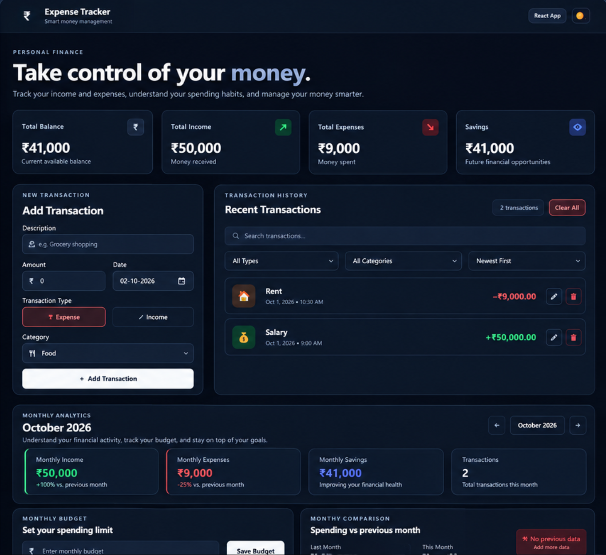
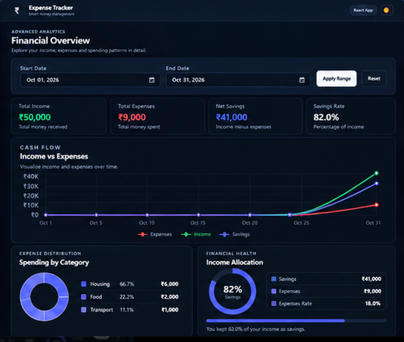
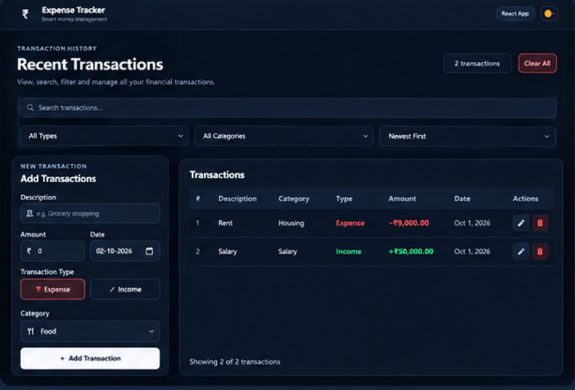

<div align="center">

# 💰 Expense Tracker

### Understand your money. Make more intentional decisions.

A clean, responsive personal finance dashboard built with **React, Vite, and Recharts**. Track transactions, manage monthly budgets, explore spending trends, and back up your data from one dashboard.

<p>
  
  
  
  
  
  
</p>

</div>

---

## Overview

**Expense Tracker** is a client-side application for organizing everyday income and expenses. Its dashboard brings balances, transaction history, monthly budgets, and interactive charts together in one place.

Search and sort transactions, compare monthly spending, review category breakdowns, switch between light and dark themes, and export your records for backup. Transactions, budgets, and theme preference are stored in your browser using Local Storage. No account or backend is required.

> **Privacy:** This is a browser-only finance tracker. Data is not encrypted by the app, synced across devices, or backed up to a server. Screenshots and any example records included with the project should be fictional before publishing.

## Features

### Transaction management
- Create, edit, and delete income or expense transactions.
- Search, filter by type/category, and sort transaction history.
- Clear all transactions after confirmation.
- Validate descriptions, dates, transaction types, and positive finite amounts.

### Financial overview
- Summary cards for balance, income, expenses, and savings.
- Monthly income, expense, savings, and transaction totals.
- Per-month budgets, progress indicators, and over-budget warnings.
- Previous-month comparisons and a 12-month spending trend.
- Date-range analysis, daily activity, and category breakdown charts.

### Data portability and preferences
- Export transactions as JSON backups or CSV files.
- Import validated JSON backups with transaction-count and file-size limits.
- Protect CSV exports from common spreadsheet formula-injection patterns.
- Light/dark theme toggle with browser-side preference persistence.
- Responsive layouts for desktop, tablet, and mobile.

## Screenshots

### Dashboard


### Monthly and advanced analytics


### Transaction management


## Tech stack

| Technology | Purpose |
|---|---|
| React | Component-based user interface |
| Vite | Development server and production builds |
| JavaScript (ES modules) | Application logic and data handling |
| CSS3 | Styling, responsive layout, and dark mode |
| Recharts | Financial data visualizations |
| React Icons | Interface icons |
| Browser Local Storage | Local persistence |
| ESLint | Static code-quality checks |
| Node.js test runner | Unit tests for validation and CSV safety |

## Getting started

### Requirements
- Node.js `20.19+` or `22.12+`
- npm
- A modern web browser

### Install and run

```bash
git clone https://github.com/samyakdutta835/expense-tracker-app.git
cd expense-tracker-app
npm install
npm run dev
```

Open the local URL printed by Vite in your terminal.

> Run `npm install` after checking out this release to generate a fresh `package-lock.json` for the updated Vite dependency. Commit the generated lockfile after verifying it.

## Available commands

| Command | Description |
|---|---|
| `npm install` | Install dependencies and generate/update the lockfile |
| `npm run dev` | Start the development server |
| `npm run lint` | Run ESLint |
| `npm run test` | Run the Node.js unit tests |
| `npm run build` | Build the production app into `dist/` |
| `npm run preview` | Preview the production build locally |
| `npm run check` | Run lint, tests, and production build |

## Project structure

```text
expense-tracker-app/
├── public/
│   ├── favicon.svg
│   └── icons.svg
├── screenshots/
│   ├── analytics.png
│   ├── dashboard.png
│   └── transactions.png
├── src/
│   ├── assets/
│   ├── components/
│   ├── styles/
│   ├── utils/
│   │   ├── csv.js
│   │   └── transactions.js
│   ├── App.jsx
│   ├── index.css
│   └── main.jsx
├── tests/
│   └── transactions.test.js
├── .gitignore
├── eslint.config.js
├── index.html
├── LICENSE
├── package.json
├── README.md
└── vite.config.js
```

## Data storage and backup

The app stores its transaction list, monthly budgets, and theme preference in browser Local Storage. Those values stay in the current browser profile only. Clearing site data can delete them, and they do not follow you to another device. Use **JSON Backup** regularly if you need a separate copy.

Importing a backup validates every record and rejects malformed data before replacing the current list. The importer has a 5 MB file limit and a 10,000-transaction limit. CSV text fields beginning with common spreadsheet formula markers are prefixed to reduce formula-injection risk.

## Important limitations

- No authentication, server, cloud sync, bank connection, or payment feature is included.
- Local Storage is not encrypted by the app. Do not enter sensitive bank credentials or use this app as a secure financial record system.
- Financial summaries reflect the records entered by the user and are not financial advice.

## Future improvements
- [ ] Recurring transactions and scheduled payments.
- [ ] Savings goals and custom categories.
- [ ] Optional encrypted backup and restore.
- [ ] Automated browser tests and accessibility checks.
- [ ] Optional account-based cloud sync with a secure backend.

## Contributing

1. Fork the repository.
2. Create a feature branch: `git checkout -b feature/your-improvement`.
3. Make your changes and run `npm run check`.
4. Commit your changes and open a pull request with a clear explanation.

## License

Distributed under the **MIT License**. See [`LICENSE`](LICENSE) for details.

## Author

**Samyak Dutta** · Computer Science Student · Front-End Developer

---

<div align="center">

**Make your money easier to understand.**

If you find this project useful, consider giving the repository a ⭐ on GitHub.

</div>
